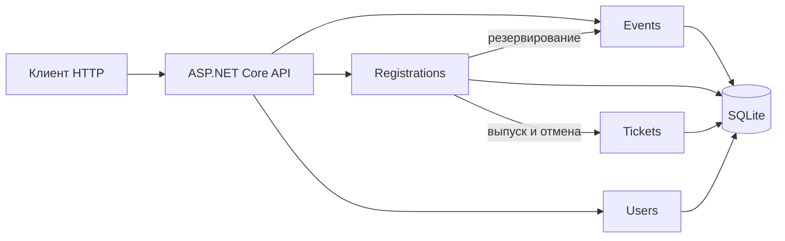

# Уточнение проекта перед реализацией

## Исходное состояние

На начале работы ветка `main` содержит исходную документацию, но в отслеживаемых файлах нет решения .NET, исходного кода или тестов. Существующие файлы `1_baseline.md` - `24_summary.md` и ADR сохранены как проектные материалы; обозначенные в них возможности и схемы являются планом, а не доказательством работающего приложения.

## Учебная реализация

Разрабатывается локальный ASP.NET Core API для мероприятий. Первая версия должна поддерживать создание и просмотр мероприятий, создание участника, регистрацию с проверкой свободных мест и дубликатов, отмену регистрации, получение билета и отметку прохода. Основные данные планируется сохранять в SQLite. QR-код должен содержать случайный код билета, проверяемый по данным приложения.

Первая версия не реализует вход, права организатора, полноценную защиту API, платежи, email и многопользовательский веб-интерфейс. Идентификатор участника не является подтверждением личности. API использовать только локально с учебными данными; для развёртывания в сети потребуются аутентификация, авторизация, защита данных и отдельный аудит.

## Модули и зависимости

- **Events**: каталог, лимиты и резервирование места.
- **Registrations**: проверка участника и повторов, координация регистрации и отмены.
- **Tickets**: выпуск и проверка билета, QR-код и отметка прохода.
- **Users**: минимальный учёт участников без входа в систему.
- **API**: HTTP-контракты и сопоставление ошибок; бизнес-правила находятся вне обработчиков.

Существующие [протокол резервирования](11_protocol-1.md) и [протокол выпуска билета](12_protocol-2.md) определены до интеграции. При реализации их необходимо согласовать с фактическими сигнатурами, ошибками и границами транзакции. Заявленные ранее сетевые таймауты и авторизация не считаются реализованными без кода и подтверждающих проверок.

## Реестр текущих артефактов

| Артефакт | Текущее расположение | Статус |
|---|---|---|
| Границы и модули | [2_project-scope.md](2_project-scope.md), [4_modules.md](4_modules.md) | Имеются, содержат общий план |
| Схема и зависимости | [5_architecture.md](5_architecture.md), [7_internal_dependencies.md](7_internal_dependencies.md), [8_external_dependencies.md](8_external_dependencies.md) | Имеются, могут уточняться |
| DTO и HTTP API | [9_core_dtos.md](9_core_dtos.md), [10_contracts.md](10_contracts.md) | Описаны, кода ещё нет |
| Протоколы | [11_protocol-1.md](11_protocol-1.md), [12_protocol-2.md](12_protocol-2.md) | Описаны, реализация планируется |
| Стратегия проверок | [15_testing.md](15_testing.md) | Описана, тестового проекта пока нет |
| Решения | [decisions/](decisions/) | Имеются ADR-001 и ADR-002 |
| Сборка и запуск | [14_quickstart.md](14_quickstart.md) | Команды плановые до создания решения |
| Текущий документ и отчёты этапов | [25_plan_realisatsii.md](25_plan_realisatsii.md), [stages/](stages/) | Создаются |

## Сборка и проверка

Целевая среда - .NET SDK 9, Git и доступ к NuGet для первого восстановления. После создания кода: `dotnet restore`, `dotnet build`, `dotnet test`, `dotnet run --project src/EventManagement.Api`. Проверять отдельно успешную регистрацию, отсутствие свободного места, повтор и отмену, а также согласованность регистрации, билета и места. Ручные HTTP-проверки не заменяют автоматические тесты.

## Ведение Git и решения

Каждый этап выполняется в отдельной ветке `stage/NN-*`; отдельные `feature/*` ветки используются для моделирования командной интеграции модулей. Коммиты небольшие и понятные, без искусственного изменения времени. Новое решение: ADR-003 - сохранить модульные границы внутри учебного решения, но не считать нереализованную авторизацию или функциональность готовой. При расширении проекта обновить описание, тесты и риски.
